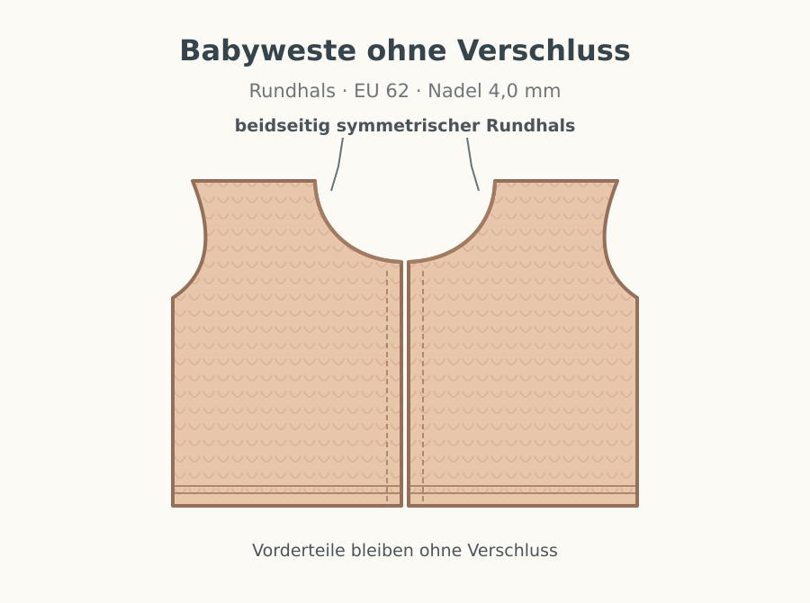

# Baby-Strickanleitungen

## Babyweste EU 62 · Rundhalsausschnitt · Nadelstärke 4 mm

Zwei Varianten derselben Babyweste: **mit drei angenähten Druckknöpfen** oder **vorne offen ohne Verschluss**. Alle Teile werden flach gestrickt. Beide Modelle haben einen **Rundhalsausschnitt (keinen V-Ausschnitt)**.

| Variante | Markdown | PDF | Bild |
|---|---|---|---|
| Mit Druckknöpfen | [Anleitung](anleitungen/babyweste-62-mit-druckknoepfen.md) | [Druck-PDF](pdf/babyweste-62-mit-druckknoepfen.pdf) | [Ansicht](bilder/babyweste-62-mit-druckknoepfen.svg) |
| Ohne Druckknöpfe, vorne offen | [Anleitung](anleitungen/babyweste-62-ohne-verschluss.md) | [Druck-PDF](pdf/babyweste-62-ohne-verschluss.pdf) | [Ansicht](bilder/babyweste-62-ohne-verschluss.svg) |

[Maß- und Schnittskizze als SVG](bilder/babyweste-62-schnitt.svg)

### Vorschau

### Eckdaten

- **Größe:** EU 62, ca. 50–51 cm Brustumfang, ca. 26 cm Länge.
- **Nadeln:** ausschließlich **4,0 mm**.
- **Maschenprobe:** 22 Maschen × 30 Reihen = 10 × 10 cm in glatt rechts.
- **Material:** ca. 100–120 g weiches Babygarn (120–130 m/50 g).
- **Konstruktion:** ein Rückenteil, zwei Vorderteile, kraus rechte Blenden, Rundhals.

**Hinweise:** Die Vektorbilder sind schematische Strickillustrationen, keine Fotografien. Die Maschenprobe und die Passform an einem passenden Kleidungsstück prüfen. Druckknöpfe müssen sicher angenäht sein.

Stand: Oktober 2026.
