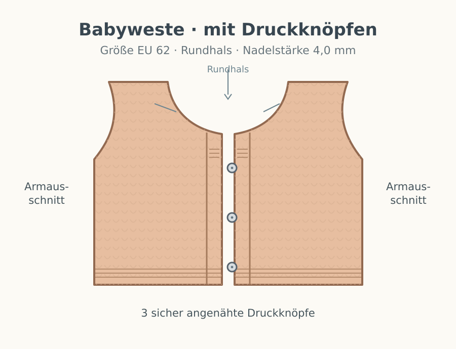
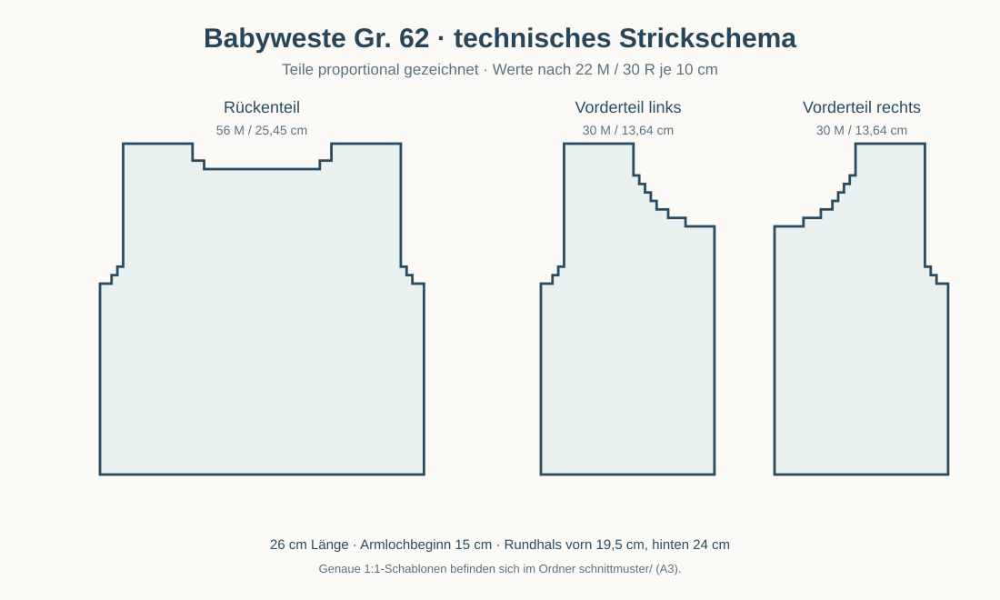

# Babyweste Größe 62 – Rundhals mit Druckknöpfen

**Größe 62 (EU)** · **ausschließlich Stricknadeln 4,0 mm** · glatt rechts mit kraus rechten Abschlüssen · in drei Teilen gestrickt.

> **Wichtig:** Die Größe gilt für die unten angegebene Maschenprobe. Vor Beginn eine gewaschene und getrocknete Maschenprobe anfertigen. Das Strickstück an einem gut passenden Kleidungsstück gegenprüfen.

## Maße und Material

| Angabe | Wert |
|---|---|
| Fertiger Brustumfang | ca. 50 cm (mit 5 Maschen überlappenden Leisten) |
| Gesamtlänge | ca. 26 cm |
| Armlochtiefe | ca. 11 cm |
| Garn | ca. 100–120 g weiches, waschbares Babygarn |
| Empfohlene Lauflänge | ca. 120–130 m je 50 g |
| Stricknadeln | 4,0 mm (gerade Nadeln oder Rundstricknadel zum flachen Stricken) |
| Maschenprobe | **22 Maschen und 30 Reihen = 10 × 10 cm**, glatt rechts nach dem Waschen |
| Zusätzlich | Wollnadel, Schere, Maschenmarkierer, **3 kleine, annähbare Druckknöpfe** |

**Grundmuster:** Glatt rechts = Hinreihe rechts, Rückreihe links. Kraus rechts = jede Reihe rechts. Die fünf Maschen jeder vorderen Blende werden stets kraus rechts gestrickt. Randmaschen sind in den genannten Maschenzahlen enthalten.

**Maschen- und Rechenkontrolle:** Mit einer Überlappung der Blenden um 5 Maschen ergibt sich

$
56+2\cdot30-5=111\ \text{Maschen}.
$

Bei 22 Maschen pro 10 cm entspricht das etwa 50,5 cm Brustumfang.

**Maßhaltiger Schnitt (A3, 1:1):** [Rückenteil und Vorderteile mit Druckknopfpositionen als PDF](../schnittmuster/babyweste-62-schnitt-1zu1-mit-druckknoepfen-A3.pdf). [Erläuterungen zur Maßhaltigkeit](../schnittmuster/README.md).

## 1. Rückenteil

1. **56 Maschen** mit Nadel **4 mm** anschlagen.
2. **8 Reihen kraus rechts** für das untere Bündchen stricken.
3. Glatt rechts weiterstricken, bis das Teil **15 cm Gesamthöhe** erreicht.
4. **Armausschnitte:** Beidseitig je **2 Maschen** abketten; danach beidseitig in jeder zweiten Reihe **2 × 1 Masche** abnehmen. **Kontrolle: 48 Maschen.**
5. Weiter glatt rechts stricken bis **24 cm Gesamthöhe**.
6. **Rückwärtiger Rundhals:** Die **mittleren 20 Maschen** abketten. Beide Schultern getrennt stricken. Am inneren Halsausschnittrand jeweils noch **1 × 2 Maschen** abketten.
7. Es verbleiben **je 12 Schultermaschen**. Bei **26 cm Gesamthöhe** locker abketten.

**Kontrolle Rückenteil:**

$
56-2(2+1+1)=48,\qquad
\frac{48-20}{2}-2=12\ \text{Schultermaschen}.
$

## 2. Erstes Vorderteil

1. **30 Maschen** mit Nadel **4 mm** anschlagen.
2. **8 Reihen kraus rechts** für das untere Bündchen stricken.
3. Weiter glatt rechts, aber **die 5 Maschen an der vorderen Öffnung fortlaufend kraus rechts** als Knopf- bzw. Vorderblende stricken. **Keine Knopflöcher** arbeiten.
4. Bei **15 cm Gesamthöhe** an der **äußeren Seitenkante** für den Armausschnitt **1 × 2 Maschen** abketten; anschließend an derselben Kante in jeder zweiten Reihe **2 × 1 Masche** abnehmen. **Kontrolle: 26 Maschen.**
5. Bei **19,5 cm Gesamthöhe** an der **vorderen Kante** den Rundhalsausschnitt formen: **1 × 5 M**, danach in jeder zweiten Reihe **1 × 3 M, 1 × 2 M und 4 × 1 M** abketten bzw. abnehmen.
6. Es verbleiben **12 Schultermaschen**. Gerade weiterarbeiten und bei **26 cm Gesamthöhe** locker abketten.

**Kontrolle Vorderteil:**

$
30-\underbrace{(2+1+1)}_{\text{Armausschnitt}}
-\underbrace{(5+3+2+1+1+1+1)}_{\text{Rundhals}}
=12\ \text{Schultermaschen}.
$

## 3. Zweites Vorderteil

Das zweite Vorderteil **spiegelverkehrt** zum ersten stricken. Die fünf kraus rechten Blendenmaschen liegen wieder ausschließlich an der vorderen Öffnung, die Armausschnittabnahmen an der **anderen, äußeren Seitenkante**. Die Halsabnahmen erfolgen ebenfalls spiegelverkehrt.

**Hinweis zum Abketten am Reihenende:** Maschen werden üblicherweise am Reihenanfang abgekettet. Liegt die zu formende Kante gerade am Reihenende, erst die Reihe beenden und die nötigen Maschen am Anfang der nächsten Reihe abketten. Dadurch können die beiden Vorderteile um eine Reihe versetzt sein; das ist unproblematisch.

## 4. Fertigstellung

1. Die **beiden Schulternähte** mit jeweils 12 Maschen schließen.
2. Die **Seitennähte** von unten bis zum Beginn des Armausschnitts schließen.
3. Für jede **Armausschnittblende** rundherum mit Nadel 4 mm ungefähr **50–56 Maschen** aufnehmen (an senkrechten Kanten etwa 3 M aus 4 Reihen). **4 Runden kraus rechts** stricken: abwechselnd eine Runde rechts, eine Runde links. Locker abketten.
4. Für den **Rundhalsausschnitt** von einer vorderen Halskante über den Rücken bis zur anderen Halskante etwa **65–75 Maschen** aufnehmen, den tatsächlichen Kantenverlauf gleichmäßig ausgleichen. **4 Reihen kraus rechts** flach stricken und **locker abketten**.
5. Alle Fäden vernähen. Die Weste entsprechend der Garnpflege waschen und **liegend** auf die Maße trocknen lassen.

## 5. Druckknöpfe annähen

- **Drei kleine, annähbare Druckknöpfe** in den jeweils fünf Maschen breiten Vorderblenden platzieren.
- Richtwerte für die Höhen ab Unterkante: **5 cm, 11 cm und 17 cm**.
- Die Blenden beim Schließen **um etwa 5 Maschen (ca. 2,3 cm) überlappen** lassen. Erst die Position der drei Gegenstücke markieren, damit die Leisten ohne Zug glatt liegen.
- Die Druckknöpfe **mit mehreren festen Stichen** annähen; Fadenenden sicher vernähen. **Keine aufbügelbaren oder ungesichert eingepressten Kleinteile** verwenden.

**Sicherheit bei Babykleidung:** Vor jedem Tragen prüfen, dass alle Druckknöpfe fest sitzen. Keine losen Verzierungen oder langen Bindebänder anbringen.

## Tipps

- Für den beschriebenen Sitz ist die **Maschenprobe entscheidend**; 4-mm-Nadeln allein garantieren keine bestimmte Weite.
- **Höhen in Zentimetern messen** statt starre Reihenzahlen zu verwenden: Die angegebene Reihendichte ist eine Orientierung.
- Beim Tragen dürfen Hals und Armausschnitte nicht einschnüren. An einer gut passenden Babyweste nachmessen.
- Die neuen technischen A3-Strickschnitte sind **1:1** bei Druck auf tatsächliche Größe; die Modellillustrationen bleiben schematisch.

[← Zur Übersicht](../README.md)
