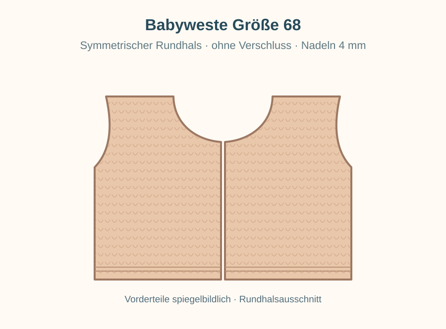
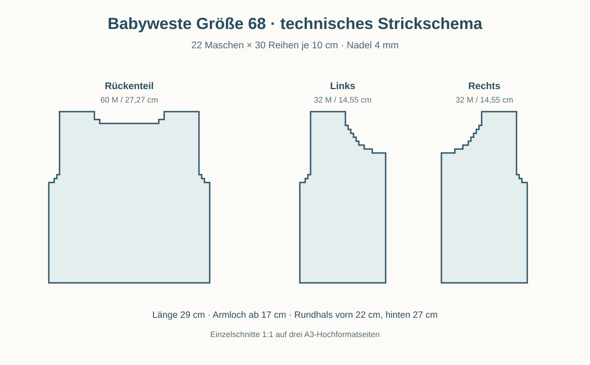

# Babyweste Größe 68 – Rundhals ohne Verschluss

**Größe 68 (EU)** · **Stricknadeln 4,0 mm** · glatt rechts mit kraus rechten Abschlüssen · drei flach gestrickte Teile.

> Maßgeblich ist die gewaschene Maschenprobe: **22 Maschen × 30 Reihen = 10 × 10 cm**. Die Nadelstärke allein garantiert nicht die Größe.

## Maße und Material

| Eigenschaft | Wert |
|---|---|
| Fertige Länge | ca. **29 cm** |
| Umfang | offen, rechnerisch **56,4 cm** bei Kantenkontakt |
| Breite Rückenteil | 60 M = **27,27 cm** |
| Breite je Vorderteil | 32 M = **14,55 cm** |
| Armlochausschnitt | Beginn bei 17 cm; Höhe 12 cm |
| Garn | ca. 120–150 g weiches Babygarn; 120–130 m / 50 g |
| Nadeln | 4,0 mm (durchgehend) |
| Zusätzlich | Wollnadel und Maschenmarkierer |

**Muster:** Glatt rechts: Hinreihe rechts, Rückreihe links. Kraus rechts: jede Reihe rechts. Die fünf Maschen jeder vorderen Blende bleiben kraus rechts. Alle genannten Maschenzahlen enthalten die Randmaschen.

**Berechnung der Weite:**

$$
60+2\cdot32=124\ \mathrm M,\qquad\frac{124}{22}\cdot10\ \mathrm{cm}\approx56{,}4\ \mathrm{cm}.
$$

**Maßhaltige Schnittmuster:** [PDF auf 3 Seiten A3, 1:1](../schnittmuster/babyweste-68-schnitt-1zu1-ohne-verschluss-A3.pdf) · [Druck- und Maßhinweise](../schnittmuster/README-68.md). In **A3 Hochformat** auf **100 % / tatsächliche Größe** drucken.

## 1. Rückenteil

1. Mit **Nadel 4 mm 60 Maschen** anschlagen.
2. **8 Reihen kraus rechts** als unteren Abschluss stricken.
3. Glatt rechts weiterarbeiten, bis **17 cm Gesamthöhe** erreicht sind.
4. **Armausschnitte:** Auf beiden Seiten zunächst **2 Maschen** abketten, dann beidseitig in jeder zweiten Reihe **2 × 1 Masche** abnehmen. Es bleiben **52 Maschen**.
5. Weiter glatt rechts stricken bis **27 cm Gesamthöhe**.
6. **Hinterer Rundhals:** Die **mittleren 22 Maschen** abketten. Schultern getrennt weiterarbeiten, am jeweiligen Halsrand zusätzlich **1 × 2 Maschen** abketten.
7. Die verbleibenden **13 Maschen je Schulter** bei **29 cm Gesamthöhe** locker abketten.

**Maschenkontrolle Rückenteil:**

$$
60-2(2+1+1)=52,\qquad
\frac{52-22}{2}-2=13\ \text{Schultermaschen}.
$$

## 2. Erstes Vorderteil

1. Mit **Nadel 4 mm 32 Maschen** anschlagen.
2. **8 Reihen kraus rechts** stricken.
3. Glatt rechts weiterstricken und an der **vorderen Öffnung 5 Maschen kraus rechts** als Blende arbeiten. **Keine Knopflöcher** vorsehen.
4. Bei **17 cm Gesamthöhe** an der **äußeren Kante 2 Maschen** abketten, dann in jeder zweiten Reihe an dieser Kante **2 × 1 Masche** abnehmen. Es bleiben **28 Maschen**.
5. Ab **22 cm Gesamthöhe** an der **vorderen Kante** den Rundhals formen: **1 × 5 Maschen**, danach in jeder zweiten Reihe **1 × 3 M, 1 × 2 M und 5 × 1 M** abketten bzw. abnehmen.
6. Die verbleibenden **13 Schultermaschen** bis **29 cm Gesamthöhe** gerade weiterarbeiten und locker abketten.

**Maschenkontrolle Vorderteil:**

$$
32-\underbrace{(2+1+1)}_{\text{Armausschnitt}}
-\underbrace{(5+3+2+1+1+1+1+1)}_{\text{Rundhals}}
=13\ \text{Schultermaschen}.
$$

## 3. Zweites Vorderteil

Das zweite Vorderteil **spiegelverkehrt** stricken: Blende an der vorderen Öffnung, Armlochausschnitt an der äußeren Seitenkante, Halsabnahmen an der vorderen Kante. Beide Halbausschnitte ergeben nach dem Zusammennähen einen **symmetrischen Rundhals und keinen V-Ausschnitt**.

**Abketten am Reihenende:** Die Abkettung gegebenenfalls zu Beginn der nächsten Reihe ausführen. Ein geringer Reihenversatz zwischen den gespiegelten Vorderteilen ist unproblematisch.

## 4. Zusammennähen und Abschlussblenden

1. Die Schulternähte mit **je 13 Maschen** schließen.
2. Die Seitennähte bis zum Beginn der Armausschnitte bei **17 cm** schließen.
3. Je Armausschnitt mit Nadel 4 mm ungefähr **55–62 Maschen** aufnehmen. **Vier Runden kraus rechts** stricken (abwechselnd eine Runde rechts / eine Runde links), locker abketten.
4. Am gesamten Rundhalsausschnitt ungefähr **70–82 Maschen** gleichmäßig aufnehmen. **Vier Reihen kraus rechts** stricken und locker abketten. Die genaue Maschenzahl an einer glatt liegenden Kante ausrichten.
5. Fäden sicher vernähen, die Weste entsprechend der Garnpflege waschen und liegend auf die Maße trocknen.

## 5. Ohne Verschluss

Die beiden Vorderblenden bleiben **vorne offen**, ohne Knopflöcher, Druckknöpfe oder Bänder. Die Weste hat offen getragen keinen fest definierten Umfang. Gegen Einrollen können je 7 statt 5 M kraus rechts gestrickt werden, ohne die gesamte Maschenzahl zu verändern.

## Maschenprobe und Passform

Die Endmaße hängen von Garn und individueller Strickfestigkeit ab. Die Schnittblätter zeigen Strickkonturen **vor dem Anstricken der Hals- und Armausschnittblenden** ohne Nahtzugaben. Zur Passformkontrolle mit einer passenden Babyweste vergleichen.

[Zur Übersicht](../README.md)
 